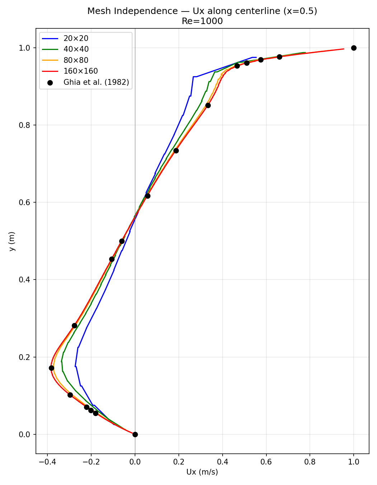

# CFD data: 2D lid-driven cavity in OpenFOAM

All models in this repository are trained and tested on the CFD data described here.

---

## Problem

A square box whose top lid moves to the right at constant speed while the other walls are stationary. Through shear, the lid drags the fluid inside and drives a vortex.

- **Solver:** OpenFOAM `icoFoam` (incompressible, laminar).
- **Domain:** L = 1 m × 1 m.
- **Boundary conditions:** the lid moves at U_lid = 1 m/s; the other three walls are stationary (no-slip).
- **Reynolds number:** Re = U_lid · L / ν. U_lid and L were kept fixed; different Reynolds numbers were obtained by changing the kinematic viscosity ν. Since U_lid = 1, the velocities are already non-dimensional (u / U_lid).

---

## Cases

| Re | ν (m²/s) | Use |
|---|---|---|
| 100 | 0.01 | training |
| 400 | 0.0025 | training |
| 700 | 0.00143 | test (RF, NN) |
| 1000 | 0.001 | training |
| 1500 | 0.000667 | test (NN) |
| 2000 | 0.0005 | training |

All cases were run to steady state, until the initial residuals fell below 10⁻⁶. An end time of 50 s was sufficient for all cases except Re = 1500, where the residuals were still at 1.3 × 10⁻⁶ at 50 s; this case was continued to 100 s (residuals ≈ 1.2 × 10⁻⁷).

---

## Mesh

80 × 80 uniform cells, selected from a mesh independence study at Re = 1000 (20×20, 40×40, 80×80 and 160×160). The results were validated against the benchmark solution of Ghia et al. (1982).

---

## Dataset

The velocity and pressure fields were extracted from the final time step of each case into CSV files:

| File | Contents |
|---|---|
| `cavity_data.csv` | Re = 100, 400, 700, 1000, 2000: 32,000 rows |
| `cavity_data_1500.csv` | Re = 1500: 6,400 rows |

- **Columns:** x, y, Re, Ux, Uy, p
- **Points:** the 6,400 cell centres of the 80 × 80 mesh, from 1/160 to 1 − 1/160 in each direction. Within each case, x varies fastest, so the rows of every case are in the same order.

---

## Files

| File | Contents |
|---|---|
| `cavity_Re*/` | OpenFOAM cases (`0/`, `constant/`, `system/`) |
| `mesh_independence.png` | Mesh independence study |
| `cavity_data.csv`, `cavity_data_1500.csv` | Extracted dataset |

---

## References

Ghia, U., Ghia, K. N., & Shin, C. T. (1982). High-Re solutions for incompressible flow using the Navier-Stokes equations and a multigrid method. *Journal of Computational Physics*, 48(3), 387–411.