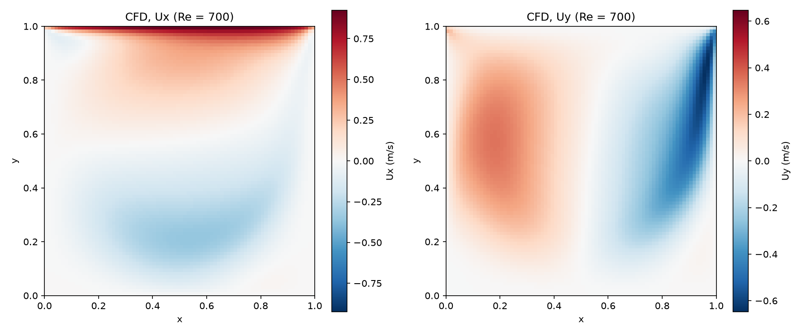
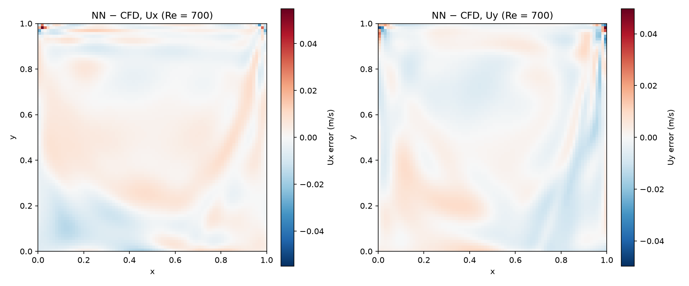
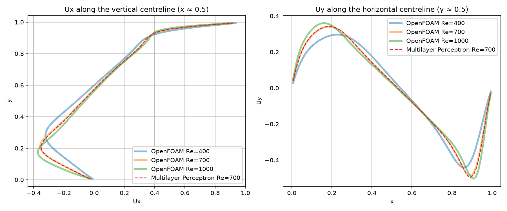
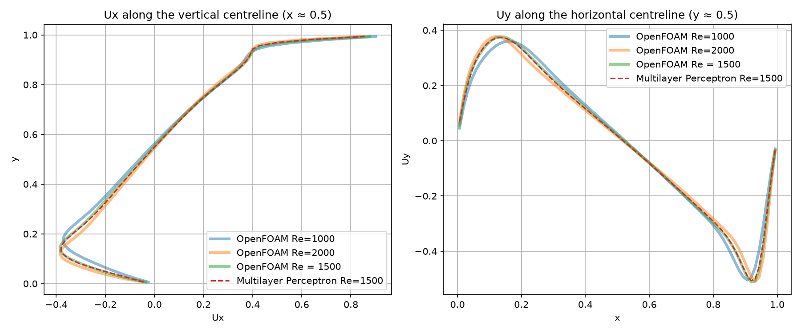

# A neural network surrogate for lid-driven cavity flow: does it interpolate in Re?

## Summary

A multilayer perceptron (MLP) trained on CFD solutions at four Reynolds numbers predicts the flow at Re = 700, which it never saw during training, with R² ≈ 0.9995 and an RMSE of about 0.5% of the lid velocity. Unlike the [Random Forest](../RF/README.md), it does not copy a neighbouring training solution: it produces a new field that lies between its neighbours.

A good score, however, has to be compared with the simplest alternative: averaging the two neighbouring CFD solutions, without any model (the averaging baseline). At Re = 700, the MLP's RMSE is about half that of the averaging baseline. At Re = 1500, it only matches it. In both cases the average has the smaller worst-case error; the MLP's largest errors are located in the top corners of the cavity.

Lesson: when a single parameter changes smoothly, linear interpolation between CFD solutions is a strong baseline. A data-driven surrogate has to be shown to beat it.

---

## 1. The question

The [RF study](../RF/README.md) showed that a Random Forest cannot interpolate along a sparsely sampled parameter: at Re = 700 it returns the Re = 400 solution unchanged. A neural network, by contrast, is a continuous function of its inputs, so it can produce a field between the training cases.

The questions in this study:

> 1. Does an MLP trained on the same four Reynolds numbers predict the flow at an unseen Re correctly?
> 2. Does it do better than simply averaging the two neighbouring CFD solutions?

Two test cases were used: Re = 700 (the same as in the RF study) and Re = 1500, which lies in the wider gap between 1000 and 2000.

---

## 2. Notation

| Notation | Meaning |
|---|---|
| **CFD(700)** | Velocity field computed by OpenFOAM at Re = 700. Used as the reference ("true answer") |
| **NN(700)** | Prediction of the trained MLP when queried at Re = 700 |
| **Avg(400, 1000)** | ½ [CFD(400) + CFD(1000)]: the average of the two neighbouring training solutions, used as a baseline for Re = 700 |
| **Avg(1000, 2000)** | ½ [CFD(1000) + CFD(2000)]: the same baseline for Re = 1500 |

There is **only one MLP**. It was trained once; NN(700) and NN(1500) were obtained by querying the same model at different Reynolds numbers.

Since 700 lies exactly halfway between 400 and 1000, and 1500 halfway between 1000 and 2000, each average is the same as **linear interpolation in Re** between the neighbouring solutions.

---

## 3. Setup

### CFD data

The same OpenFOAM data as in the RF study, plus one additional case at Re = 1500. The solver, mesh, mesh independence study and validation are described in [CFD/README.md](../CFD/README.md).

### Dataset

- 6,400 cell centres per Reynolds number (80 × 80).
- **Inputs:** x, y, Re
- **Outputs:** Ux, Uy
- **Training:** Re = 100, 400, 1000, 2000 → 25,600 points
- **Test:** Re = 700 and Re = 1500 → 6,400 points each

### Scaling

- **Inputs:** min-max scaling to [0, 1]. The minimum and maximum were computed from the **training data only** and applied unchanged to the test data. x and y are already in [0, 1]; the scaling matters mainly for Re (100–2000), which would otherwise saturate the activation functions.
- **Outputs:** not scaled. With U_lid = 1 m/s, Ux and Uy are already of order 1 (between about −0.65 and 1), so the predictions come out directly in m/s.

### Model

PyTorch MLP with three hidden layers of 64 neurons:

**3 → 64 → 64 → 64 → 2**

- **Activation:** Tanh between the layers, none after the output layer (Ux and Uy take both signs). Tanh was chosen over ReLU because it gives a smooth output field, and because the same architecture can later be reused for a physics-informed network, which needs second derivatives.
- **Parameters:** 8,706 weights and biases.

### Training

| Setting | Value |
|---|---|
| Loss | Mean squared error (MSE) |
| Optimizer | Adam, initial learning rate 10⁻³ |
| Mini-batches | 256 points, shuffled every epoch (100 updates per epoch) |
| Learning-rate schedule | Halved every 300 epochs (`StepLR`, γ = 0.5) |
| Epochs | 1,000 |
| Random seed | 42 |

---

## 4. Results

### 4.1 Training settings matter as much as the network

The same network was trained in three ways. Only the way the weights are updated changes:

| Training | Weight updates (optimizer steps) | Final training loss | Ux RMSE / max | Uy RMSE / max |
|---|---|---|---|---|
| Full batch, constant learning rate, 5,000 epochs | 5,000 | 7 × 10⁻⁴ | 0.018 / 0.146 | 0.031 / 0.268 |
| Mini-batch, constant learning rate, 1,000 epochs | 100,000 | 2–4 × 10⁻⁵ | 0.006 / 0.064 | 0.008 / 0.050 |
| **Mini-batch + learning-rate schedule** | 100,000 | **1 × 10⁻⁵** | **0.005 / 0.055** | **0.005 / 0.050** |

(Errors at Re = 700, in m/s.)

The first two rows were obtained with modified versions of the training cell in the notebook.
- With the full training set in every step, the network makes one update per epoch. Even after 5,000 epochs it was still **underfitting**: the error at Re = 700 reached 0.27 m/s in places (see 4.4).
- Mini-batches give 100 updates per epoch, i.e. 20 times more updates in a fifth of the epochs. This alone reduced the RMSE by a factor of 3–4.
- With a constant learning rate, the loss curve showed periodic spikes: near the minimum, a step of fixed size sometimes overshoots. Halving the learning rate every 300 epochs removed most of this noise and lowered the loss further.

All results below use the last model.

### 4.2 Re = 700: the MLP against the baselines

All predictions were scored against the same reference, CFD(700):

| Against CFD(700) | Ux R² | Uy R² |
|---|---|---|
| Random Forest RF(700) | 0.966 | 0.972 |
| Copy of CFD(400) | 0.966 | 0.972 |
| Copy of CFD(1000) | 0.989 | 0.991 |
| Avg(400, 1000) | 0.9971 | 0.9976 |
| **NN(700)** | **0.9995** | **0.9995** |

(The first three rows are from the [RF study](../RF/README.md).)

The MLP is clearly not a copy: it beats both copies and the RF. The relevant comparison is the average:

| Against CFD(700) | Ux RMSE | Ux max | Uy RMSE | Uy max |
|---|---|---|---|---|
| Avg(400, 1000) | 0.0115 | **0.039** | 0.0095 | **0.038** |
| NN(700) | **0.0047** | 0.055 | **0.0045** | 0.050 |

- **On average, the MLP is better:** its RMSE is about 2–2.5 times lower than that of the average.
- **At the worst point, the average is better:** its maximum error is about 0.04 m/s, the MLP's about 0.05 m/s.

Avg(400, 1000) also serves as a reference for the NN prediction itself. NN(700) and Avg(400, 1000) differ by an RMSE of about 0.012, about as much as Avg(400, 1000) differs from CFD(700). Since NN(700) is closer to CFD(700), its departure from linear interpolation is towards the true solution: the MLP has learned something in the Re direction beyond linear interpolation.

### 4.3 Where are the errors?

Top: CFD(700). Bottom: the error NN(700) − CFD(700). Note the different colour scales: about ±1 m/s for the flow, about ±0.05 m/s for the error.

- In the interior of the cavity, the error is about ±0.01 m/s and varies smoothly, in large patches.
- The largest errors are in the **two top corners** and in a thin band just below the lid. The maximum Uy error is in the top-right corner cell, at (x, y) ≈ (0.99, 0.98).

This is where the flow is hardest to represent. At the top corners, the boundary condition itself is discontinuous: the lid moves at 1 m/s, the side wall is at rest. The velocity changes from one value to the other within a cell, and even the CFD solution there depends on the mesh. A smooth function such as an MLP tends to spread such sharp changes over a few cells.

### 4.4 Fit error or interpolation error?

A large error at Re = 700 can have two causes:

- **Interpolation error:** the model fits the training cases, but behaves incorrectly between them.
- **Fit error (underfitting):** the model is not accurate even on the training cases.

To tell them apart, the model was queried at the same cell for **all five** Reynolds numbers, including the four training cases. The cell below is in the top-right corner region, (x, y) = (0.99, 0.93), where the flow coming along the lid turns down along the right wall:

| Re | 100 | 400 | **700** | 1000 | 2000 |
|---|---|---|---|---|---|
| CFD Uy | −0.181 | −0.301 | **−0.386** | −0.452 | −0.567 |
| NN Uy | −0.192 | −0.330 | **−0.416** | −0.465 | −0.570 |
| Error | 0.011 | 0.029 | **0.030** | 0.013 | 0.003 |

- There is a small **fit error**: even at the training Reynolds numbers, the MLP predicts a slightly stronger downward flow.
- There is also a small **interpolation error**: at Re = 700, CFD(700) has completed 56% of the change from Re = 400 to Re = 1000; NN(700) has completed 64%. The MLP makes the transition slightly earlier than the physics.
- NN(700) still lies between NN(400) and NN(1000): the prediction changes monotonically with Re and does not overshoot.

The same test is useful during development. For the full-batch model of 4.1, it showed errors of a factor of 2–3 at **every** Reynolds number in the cell with the largest error: a clear sign of underfitting, which the changes in training then removed.

### 4.5 Centreline profiles at Re = 700

Left: Ux along the vertical centreline (x ≈ 0.5). Right: Uy along the horizontal centreline (y ≈ 0.5).

What to look for in the figure:

- **CFD(700)** (orange) lies between its neighbours CFD(400) and CFD(1000).
- **NN(700)** (red, dashed) lies on top of CFD(700) along both lines, including the minimum of Ux near y ≈ 0.2 and the sharp minimum of Uy near the right wall (x ≈ 0.9).
- Compare with the [RF centreline figure](../RF/README.md#45-centreline-profiles), where RF(700) sits on top of CFD(400).

### 4.6 Re = 1500: a wider gap

Re = 1500 lies between 1000 and 2000, where the training cases are further apart. A new CFD case was run for it (see [CFD/README.md](../CFD/README.md)).

| Against CFD(1500) | Ux R² | Ux RMSE | Ux max | Uy R² | Uy RMSE | Uy max |
|---|---|---|---|---|---|---|
| Avg(1000, 2000) | 0.9992 | **0.0058** | **0.021** | 0.9993 | 0.0053 | **0.023** |
| NN(1500) | 0.9991 | 0.0062 | 0.068 | **0.9995** | **0.0045** | 0.043 |

- The MLP is about as accurate at Re = 1500 as at Re = 700.
- But here, the average is **just as good on average** (slightly better for Ux, slightly worse for Uy), and its maximum error is 2–3 times smaller.
- Between Re = 1000 and 2000, the flow changes almost linearly with Re, so linear interpolation between the two solutions is already very accurate.

---

## 5. What does this mean?

- **The MLP interpolates where the RF could not.** Trained on the same four simulations, it produces new, physically sensible fields between them, with errors of about 0.5% of the lid velocity.
- **Linear interpolation between CFD solutions is a strong baseline.** For one parameter that changes the flow smoothly, the average of the two neighbouring solutions is already within about 1% of the true field. The MLP beats it clearly at Re = 700, but only matches it at Re = 1500.
- **The worst-case errors are larger than the baseline's.** The MLP's largest errors sit in the top corners, where the boundary condition is discontinuous. If quantities near the walls matter (for example wall shear stress), these errors need to be checked separately.
- **R² is not enough here either.** All candidates in this study reach R² > 0.997. The differences only show up in RMSE, maximum error and in where the errors are.

Where would a neural network surrogate add more value than interpolation? When the flow depends on the parameter in a strongly non-linear way, when there are several parameters (interpolating between snapshots in many dimensions is no longer simple), or when there is no CFD solution on both sides of the query.

The MLP also has limits that the tests above do not cover: it was not tested outside the training range (Re < 100 or Re > 2000), and nothing in its training forces the predicted field to satisfy the governing equations, for example conservation of mass.

---

## 6. Next step

A **physics-informed neural network (PINN)** adds the residuals of the governing equations (continuity and momentum) to the loss, so that the network is penalised not only for disagreeing with the data, but also for violating the physics.

The expected advantages are physical consistency and the ability to learn from fewer simulations. PINNs are, however, known to be harder to train, especially at higher Reynolds numbers, so these advantages have to be shown, not assumed. The next study will therefore test whether a PINN improves on the MLP and on the interpolation baseline, using the same data, test cases and baselines as here.

---

## Files

| File | Contents |
|---|---|
| `nn_cavity.ipynb` | Data preparation, MLP training, metrics, baselines, figures |
| `NN_centerline_Re700.png` | Centreline profiles at Re = 700 |
| `NN_centerline_Re1500.png` | Centreline profiles at Re = 1500 |
| `CFD_fields_Re700.png` | CFD velocity field at Re = 700 |
| `NN_difference_Re700.png` | Error field NN(700) − CFD(700) |

The CFD data (`cavity_data.csv`, `cavity_data_1500.csv`) are in [`CFD/`](../CFD/).

---