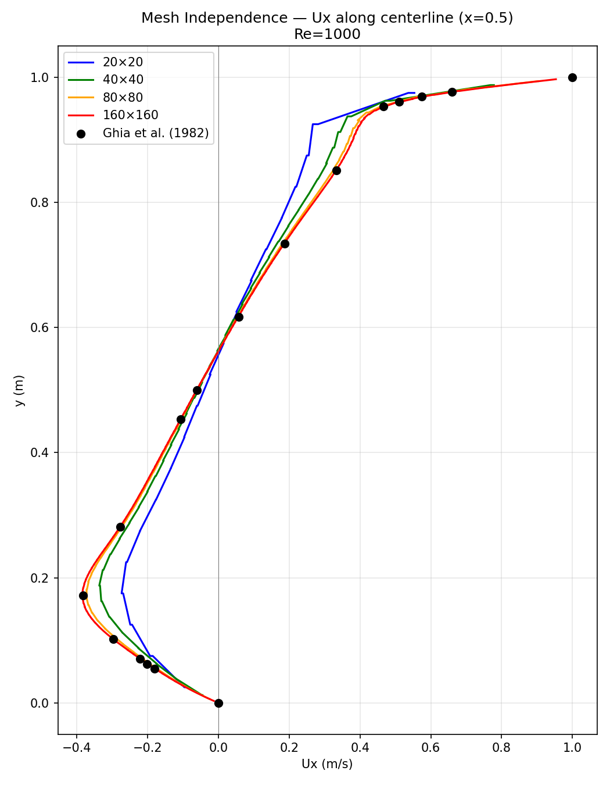
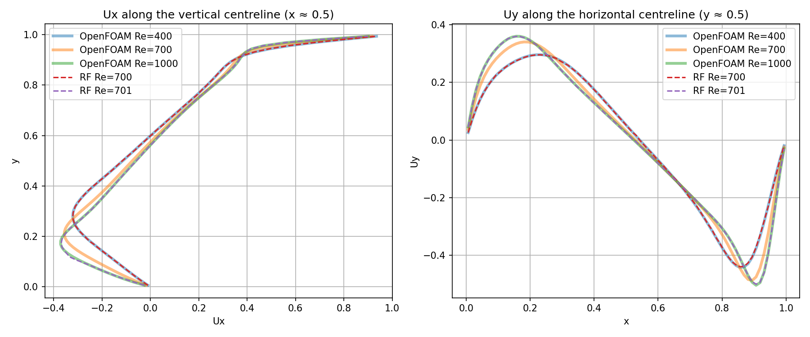

# A Random Forest surrogate for lid-driven cavity flow: what happens at an unseen Reynolds number?

## Summary

A Random Forest (RF) trained on CFD solutions at four Reynolds numbers reaches a high accuracy (R² ≈ 0.97) at Re = 700, which it never saw during training. A closer look, however, shows that the model does not produce a new flow field: it returns the Re = 400 CFD solution almost unchanged. Simply copying the Re = 1000 CFD solution, without any model, gives a better prediction than the RF.

Lesson: a high R² alone does not show that a model has learned anything. Parametric surrogates should be compared against simple baselines, such as copying the nearest training solution.

---

## 1. The question

A **surrogate model** learns from the results of an expensive simulation (here, CFD) and gives fast predictions for new cases. Instead of running CFD for every new parameter value, the model returns an answer in seconds.

The question in this study:

> Can an RF trained on a few Reynolds numbers correctly predict the flow field at a Reynolds number that lies **between** them and that it has never seen?

To test this, the Re = 700 CFD solution was held out from training and used only for evaluation.

---

## 2. Notation

The report deals with two kinds of fields: the actual solutions computed by OpenFOAM, and the predictions of the RF. To keep them apart, the following notation is used throughout:

| Notation | Meaning |
|---|---|
| **CFD(400)** | Velocity field computed by OpenFOAM at Re = 400 |
| **CFD(700)** | Velocity field computed by OpenFOAM at Re = 700. Used as the reference ("true answer") |
| **RF(700)** | Prediction of the trained RF model when queried at Re = 700 |
| **RF(701)** | Prediction of the same model when queried at Re = 701 |

Important: there is **only one RF model**. It was trained once; RF(700), RF(701) and RF(1300) were obtained by querying the same model at different Reynolds numbers.

---

## 3. Setup

### CFD data

- **Problem:** 2D lid-driven cavity. A square box whose top lid moves to the right at constant speed while the other walls are stationary. Through shear, the lid drags the fluid inside and drives a vortex.
- **Solver:** OpenFOAM `icoFoam` (incompressible, laminar).
- **Reynolds number:** Re = U_lid · L / ν. The lid velocity (U_lid = 1 m/s) and the cavity size (L = 1 m) were kept fixed; different Reynolds numbers were obtained by changing the kinematic viscosity ν. Since U_lid = 1, the velocities are already non-dimensional (u / U_lid).

| Re | ν (m²/s) | Use |
|---|---|---|
| 100 | 0.01 | training |
| 400 | 0.0025 | training |
| 700 | 0.00143 | **test** |
| 1000 | 0.001 | training |
| 2000 | 0.0005 | training |

- **Mesh:** 80×80. Selected from a mesh independence study at Re = 1000 (20×20, 40×40, 80×80 and 160×160); the results were validated against the benchmark solution of Ghia et al. (1982) (see [References](#references)).

### Dataset

- 6,400 cell centres per Reynolds number (80 × 80).
- **Inputs:** x, y, Re
- **Outputs:** Ux, Uy
- **Training:** Re = 100, 400, 1000, 2000 → 25,600 points
- **Test:** Re = 700 → 6,400 points

### Model

scikit-learn `RandomForestRegressor` with 100 trees (`n_estimators=100`) and fixed randomness (`random_state=42`). Each tree is trained on a random bootstrap sample of the training data; the prediction is the average of the 100 trees.

---

## 4. Results

### 4.1 First look: how close is RF(700) to CFD(700)?

| | Ux | Uy |
|---|---|---|
| R² | 0.966 | 0.972 |
| RMSE | 0.039 | 0.033 |
| Maximum absolute error | 0.109 | 0.115 |

At first sight, R² ≈ 0.97 looks good. The RMSE is 3–4% of the lid velocity, and the error reaches about 11% at the worst points.

### 4.2 Copy test: is this R² actually good?

To judge a model's value, it has to be compared with a simple alternative. The alternative used here is a **copy**: without any model, a neighbouring training solution (CFD(400) or CFD(1000)) is presented unchanged as the prediction for Re = 700.

All three predictions were scored against the same reference, CFD(700):

| Against CFD(700) | Ux R² | Uy R² |
|---|---|---|
| RF(700) | 0.966 | 0.972 |
| Copy of CFD(400) | 0.966 | 0.972 |
| Copy of CFD(1000) | **0.989** | **0.991** |

This observation follows from the table:

**The RF does no better than copying Re = 400.** The R² between RF(700) and CFD(700) (0.966 for Ux) equals the R² between CFD(400) and CFD(700). In other words, the RF prediction is no better than putting the Re = 400 CFD solution, unchanged, in place of Re = 700.
   
### 4.3 What is RF(700), really?

Equal R² values do not prove that two fields are the same. RF(700) was therefore compared directly with CFD(400):

| RF(700) ↔ CFD(400) | Ux | Uy |
|---|---|---|
| R² | 0.99994 | 0.99993 |
| Mean difference | 0.0008 | 0.0008 |
| Maximum difference | 0.022 | 0.026 |

RF(700) and CFD(400) are practically the same field. The small differences are concentrated in the top corners, just below the lid, where gradients are highest; they come from the scatter introduced by bootstrap sampling.

**Conclusion:** when asked for Re = 700, the RF does not produce a new flow; it returns CFD(400). The high R² in the above table measures how similar the Re = 400 and Re = 700 flows are, not how good the model is.

### 4.4 Step test: what happens if Re changes slightly?

The same model was queried at Re = 701 and Re = 1300, and the predictions were compared with the neighbouring CFD solutions:

| Prediction | R² with CFD(400) (Ux / Uy) | R² with CFD(1000) (Ux / Uy) | R² with CFD(2000) (Ux / Uy) |
|---|---|---|---|
| RF(700) | **0.9999 / 0.9999** | – | – |
| RF(701) | 0.921 / 0.928 | **0.9999 / 0.9999** | – |
| RF(1300) | – | **0.9999 / 0.9999** | 0.971 / 0.975 |

- Increasing Re from 700 to 701, **by just 1**, makes the prediction jump from CFD(400) to CFD(1000). In the real flow, the difference between Re = 700 and Re = 701 is too small to measure.
- RF(1300) is also equal to CFD(1000). Within this range, the model is insensitive to Re.

### 4.5 Centreline profiles

The same behaviour appears in the velocity profiles. Left: Ux along the vertical centreline (x ≈ 0.5). Right: Uy along the horizontal centreline (y ≈ 0.5).

What to look for in the figure:

- **CFD(700)** (orange) lies **between** CFD(400) and CFD(1000). The real flow changes continuously with Re.
- **RF(700)** (red, dashed) sits exactly on top of CFD(400).
- **RF(701)** (purple, dashed) sits exactly on top of CFD(1000).
- Neither RF curve comes close to CFD(700).

---

## 5. Why does this happen?

1. In the Re direction, the RF saw only four values: 100, 400, 1000 and 2000. There are no samples in between.
2. A decision tree splits the data with questions such as "Is Re ≤ threshold?". Any threshold between 400 and 1000 splits the training data in the same way, so scikit-learn places the threshold exactly halfway between the two values: (400 + 1000) / 2 = **700**.
3. If Re ≤ 700, the tree goes to the Re = 400 side; otherwise, to the Re = 1000 side. For the tree, there is nothing in between.
4. A query at Re = 700 gets the answer "yes" (700 ≤ 700). All 100 trees go to the Re = 400 side, and their average is CFD(400). At Re = 701 the answer is "no", and the result jumps to CFD(1000).

By the same logic, the field the model returns depends on the queried Re roughly as follows:

| Queried Re | Field returned by the model |
|---|---|
| Re ≤ 250 | ≈ CFD(100) |
| 250 < Re ≤ 700 | ≈ CFD(400) |
| 700 < Re ≤ 1500 | ≈ CFD(1000) |
| Re > 1500 | ≈ CFD(2000) |

(The 700 and 1300 queries were tested; the 250 and 1500 boundaries follow from the same logic. "Roughly", because other thresholds can appear at some tree nodes.)

In other words, the RF learns a **piecewise constant** function in Re, while the physical flow changes continuously with Re. For the same reason, the model cannot go beyond the training range (Re > 2000): it returns CFD(2000) for every higher Re.

---

## 6. What does this mean?

- **R² alone can be misleading.** An R² of 0.97 can hide a model that is no better than copying. Parametric surrogates should be reported together with simple baselines, such as copying the nearest training solution.
- **The RF cannot interpolate along a sparsely sampled parameter.** The RF is piecewise constant in x and y as well, but with 80 points in each direction the steps are small. With only 4 points in Re, the steps are as large as the changes in the flow itself.
- This does not mean the RF is useless in general; it is, however, not suitable for a CFD surrogate that is expected to learn from a small number of simulations.

---

## 7. Next step

A neural network (MLP), which can learn a continuous function of Re, will be trained and evaluated with the same tests:

- the same test data: CFD(700),
- the same copy baselines: CFD(400) and CFD(1000),
- one additional baseline: the simple average of CFD(400) and CFD(1000). If the NN beats this average, it has genuinely learned something in the Re direction.

---

## Files

| File | Contents |
|---|---|
| `cavity_data.csv` | CFD results for all Reynolds numbers (x, y, Re, Ux, Uy, p) |
| `rf_cavity_v2.py` | RF training, metrics, copy tests, step test, centreline plot |
| `rf_centerline_Re700.png` | Centreline profiles |
| `mesh_independence.png` | Mesh independence study |

---

## References

Ghia, U., Ghia, K. N., & Shin, C. T. (1982). High-Re solutions for incompressible flow using the Navier-Stokes equations and a multigrid method. *Journal of Computational Physics*, 48(3), 387–411.
